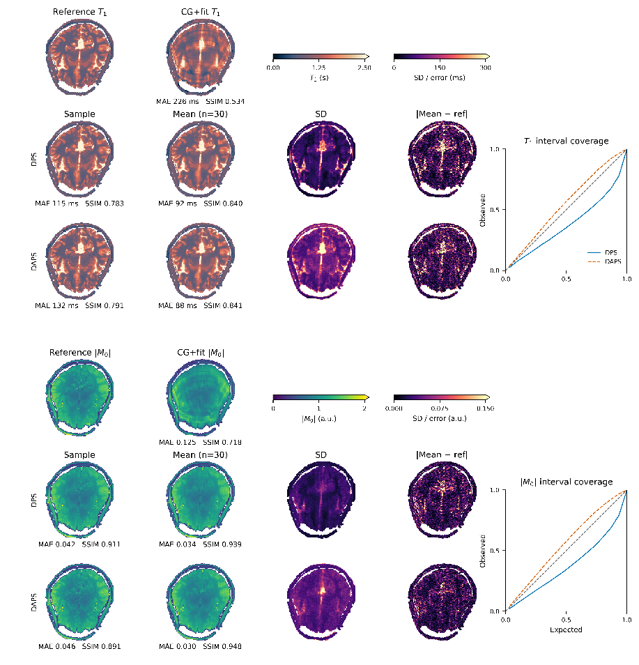

# Score-Based Posterior Sampling for Quantitative MRI

Train diffusion priors for quantitative MRI and reconstruct images from undersampled k-space. Inputs use two channels: real and imaginary for complex data, or magnitude and zeros for magnitude images and parameter maps.

## Highlights

- VE/EDM diffusion with main and auxiliary x₀ prediction heads
- UNet with adaptive group normalization conditioned on noise level and dataset kind
- Optional scaled dot-product attention (`attention_levels`)
- Karras sigma schedule and EDM validation sampling with fixed noise
- Fixed normalization scales for quantitative maps (`kind_scales`)
- DPS posterior sampling with covariance-aware or residual-norm guidance
- DAPS posterior sampling with conditional Langevin updates

## Quick Start

```bash
source .venv/bin/activate
score-qmri fit --config data.yaml --config model.yaml --job_name my-run
```

Training datasets and loader settings are in `data.yaml`; model and optimizer overrides are in `model.yaml`. Pass both files in that order. Dataset paths resolve relative to the working directory.

## Joint T₁/M₀ reconstruction

[The joint example](examples/qmri_joint.py) simulates undersampled Cartesian saturation-recovery measurements using MR2 and reconstructs both T₁ and complex M₀ with separate learned priors.



## Datasets

The training configuration in [data.yaml](data.yaml) uses the datasets below. HDF5 filenames are relative to `datasets/`; braces list separate files. See [dataset preparation](dataset_preparation/README.md) for scripts, download sources and reproduction notes.

| Dataset | HDF5 files |
| --- | --- |
| fastMRI | `fastmri_{t1,t2,flair}.h5` |
| CC MR reconstruction challenge | `cc.h5` |
| M4Raw | `m4raw_{gre,t1w,t2w,flair}.h5` |
| OpenNeuro ds000221 | `ds000221_{gre,mprage,t1w,t2w,flair,t1map}.h5` |
| OpenNeuro ds002685 | `ds002685_{t1w,t2w,flair}.h5` |
| OpenNeuro ds002785 | `ds002785_t1w.h5` |
| OpenNeuro ds002790 | `ds002790_t1w.h5` |
| OpenNeuro ds003967 | `ds003967_t1map_cropped.h5` |
| OpenNeuro ds004611 | `ds004611_{mprage,t1w,t1map,t2map}.h5` |
| OpenNeuro ds004889 | `ds004889_{t1w,flair}.h5` |
| OpenNeuro ds005851 | `ds005851_{m0_abs,t1map,t2map}.h5` |
| Deli-CS | `delics_{complexm0,t1map,t2map}.h5` |
| IBC relaxometry | `ibc_relaxo_{t1map,t2map,t2starmap,m0map,s0map,s0map_t2}.h5` |
| IXI | `ixi_{t1w,t2w,pd}.h5` |
| MRF (Zenodo 8183344) | `mrf_zenodo8183344_{t1w,t2w,t1map,t2map}.h5` |
| NIST MRF | `mrf_nist_{t1map,t2map,m0map}.h5` |
| Quiero 3D MRF reproducibility | `quiero_{t1map,t2map,m0map}.h5` |
| Radunsky quantitative maps | `radunsky_{m0mag,t1,t2,t2star}.h5` |
| ULF-EnC (3T reference scans) | `ulf_{t1,t2,flair}.h5` |
| MONAI latent diffusion (synthetic T1-weighted images) | `ldm_t1w.h5` |
| BrainWeb (simulated maps and images) | `brainweb.h5` |
| WAND | `wand_{m0_mag,m0_complex,t1map,t1w,t2w,t1w_neu}.h5` |
| NKI-Rockland | `rockland_{t1w,t2w,flair}.h5` |

## Development

```bash
pytest
ruff check .
ruff format .
mypy .
pre-commit run --all-files
```

## References

- Karras et al., NeurIPS 2022 (EDM)
- Song et al., ICLR 2021 (Score-Based SDEs)
- Chung et al., ICLR 2023 (DPS)
- Perez et al., AAAI 2018 (FiLM)
